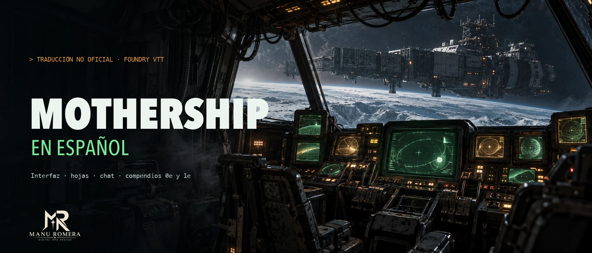
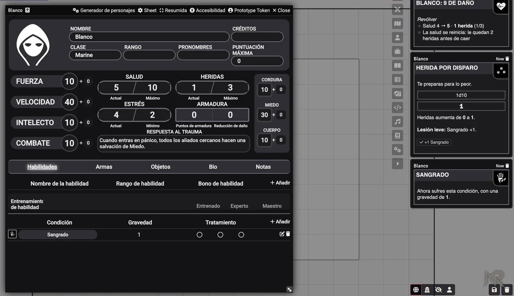
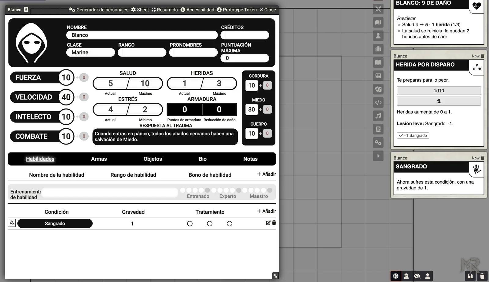
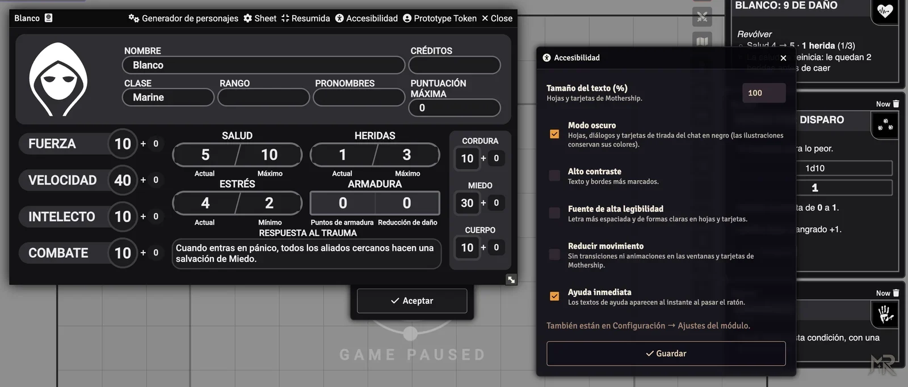

<p align="center">
  
</p>

<p align="center">
  <a href="https://github.com/ManuRomera"></a>
  <a href="https://github.com/ManuRomera/mr-mothership-es/releases/latest"></a>
  
  <a href="https://github.com/ManuRomera/mr-mothership-es/releases"></a>
  <a href="LICENSE"></a>
</p>

<h3 align="center">El sistema MoSh de Foundry, completo en español de España, con clases, equipo, generador de personajes y combate automatizado.<br>Para que lo único que dé miedo en la mesa sea la nave.</h3>

---

## ⚡ Instalación en 10 segundos

Necesitas el sistema **MoSh – Unofficial Mothership** (`mosh`) y el módulo **Babele**. En Foundry: **Add-on Modules → Install Module → Manifest URL**, pega:

```
https://github.com/ManuRomera/mr-mothership-es/releases/latest/download/module.json
```

Activa **MR- Mothership en español** en tu mundo y pon Foundry en **Español** (Configuración → Idioma). Nada más. Si tenías «Básicos de Mosh», desactívalo: este módulo lo sustituye.

<p align="center"></p>

## 📦 Qué trae

| | |
|---|---|
| 🖥️ **Traducción completa** | Las ~650 cadenas del sistema (hojas de personaje, criatura y nave, ajustes, generador, avisos) y los textos fijos que el sistema escribe en inglés dentro del código, traducidos al vuelo sin tocar el sistema. |
| 📚 **Compendios del sistema** | Condiciones, averías de mantenimiento (con descripción para interpretarlas), tablas y macros de **0e y 1e**, con Babele: los datos originales quedan intactos. |
| 🧑‍🚀 **16 clases** | Marine, Androide, Científico, Tripulante y 12 clases más (Colono, Ejecutivo, Pastor, Psiónico, Jubilado…), con bonos, respuesta al trauma, habilidades, ambientación, ejemplos de interpretación y ganchos. |
| 🧰 **Equipo** | Compendios de **habilidades** (árbol de requisitos de la hoja oficial), **armas** (cada una con su tipo de herida), **armaduras**, **objetos**, **parches** y **tablas de equipo inicial**, todo con iconos al estilo de Mothership y descripciones de catálogo. |
| 🎲 **Generador de personajes** | El generador del sistema funciona con todas las clases: respeta los caminos de habilidades (entrenada → experta → maestra), tira el equipo, el parche (d100 con imagen) y la baratija. Elige sexo y pulsa **Nombre y biografía** para recibir nombre, mote y una biografía propia, editable, a medida de la clase y lo que ha salido. |
| 🧵 **Parches (d100)** | Los 100 parches con su imagen: tarjeta al chat con **Coser a mi personaje**, tabla nativa para el mundo e integración con el generador. |
| ⚔️ **Combate automatizado** | Daño, armadura, cobertura, heridas con sus efectos, sangrado y fuego por ronda, orden por Velocidad, sorpresa, pánico y respuestas al trauma. Cada automatismo se activa o desactiva en los ajustes. |
| ♿ **Mesa** | Modo oscuro completo (hojas, diálogos y chat), tamaño del texto, alto contraste, fuente de alta legibilidad, reducir movimiento, ayuda inmediata y **ficha resumida**. |

## ⚔️ Combate según la Guía de supervivencia

Las tarjetas de daño de un arma traen dos botones: **Objetivos** (tokens marcados con T) y **Selección**. Al aplicar el daño:

- primero la **reducción de daño**; después la **cobertura** (solo a distancia) y la **armadura**, que ignoran el daño menor que sus PA y se destruyen si lo igualan o superan (las armas **antiarmadura** la ignoran y la destruyen). La armadura no se desgasta ni pide tirada: protege igual hasta que se rompe;
- **salud a 0 → 1 herida**: la salud vuelve al máximo y resta el daño sobrante, que puede encadenar varias heridas; la tarjeta dice cuántas quedan antes de caer;
- se tira en la **tabla de heridas** del arma (con su [+]/[−]; si admite varias, se pregunta cuál) y **su resultado se aplica solo**: sangrado, estrés (el de «los que estén cerca» va a los aliados), fuego de 2d10/3d10 por ronda hasta que alguien lo apague, lesiones letales con **cuenta atrás de 1d10 rondas** hasta la salvación de muerte (botón «Herida tratada») y lesiones fatales;
- con las **heridas al máximo** el personaje cae y el Guardián tira **en secreto** la salvación de muerte; las criaturas quedan muertas.

Además: **sangrado y fuego** al empezar cada turno (ignoran armadura), **orden de turno por Velocidad** (botón en el registro de combate), **sorpresa** (salvación de Miedo; quien falla queda conmocionado), **salir de cobertura al disparar**, **pánico automático** tras un fallo crítico, **respuestas al trauma** de Marine, Científico, Pastor y Androide con botón para aplicarlas a los aliados cercanos, y **estados en el token** (herido, sangrando, en llamas, armadura destruida, muriendo, conmocionado). Si un jugador aplica algo a un token que no es suyo, lo ejecuta el Guardián conectado.

<p align="center"></p>

## ♿ Mesa: accesibilidad, modo oscuro y ficha resumida

Botón **Accesibilidad** en la cabecera de las hojas (también en Configuración → Ajustes del módulo; cada persona elige los suyos):

- **Modo oscuro** de verdad: hojas, diálogos de tirada y todas las tarjetas del chat en tonos oscuros con texto claro; las ilustraciones conservan sus colores.
- **Tamaño del texto**, **alto contraste**, **fuente de alta legibilidad**, **reducir movimiento** y **ayuda inmediata** al pasar el ratón.

Botón **Resumida** en la hoja de personaje: solo características, salud, heridas, estrés, armadura, respuesta al trauma y salvaciones, en una ventana pequeña (se recuerda por personaje). La respuesta al trauma ajusta su letra para caber entera en su cuadro.

<p align="center"></p>

## 🔧 Cómo está hecho

- `lang/es.json`: idioma del sistema (se fusiona con el de `mosh` cuando el idioma es español).
- `lang/literales.json` + `scripts/mr-mothership-es.js`: diccionario de textos fijos y patrones con datos, aplicado a la interfaz según se dibuja.
- `compendium/mosh.*.json`: traducciones para Babele. `packs/`: compendios propios (clases, habilidades, armas, armaduras, objetos, parches, tablas y reglas rápidas).
- `scripts/generador.js` (nombre y biografía), `scripts/parches.js` (parches d100), `scripts/combate.js` (automatismos de combate), `scripts/mejoras.js` (accesibilidad y ficha resumida), `estilos-oscuro.css` (modo oscuro, generado desde la hoja de estilos del sistema).
- `tools/`: `extract.py`, `traducir.py` y `montar.py` (traducción), `recuperar.py` y `build.mjs` (compendios), `describir.py` y `personajes.py` (textos), `iconos.py` (iconos) y `oscuro.py` (modo oscuro).

> ℹ️ Las tablas de heridas, de pánico y la condición **Bleeding** conservan su nombre original por dentro porque el sistema las busca por ese nombre; en pantalla se ven en español.

## 🐛 Erratas

No hay edición oficial en español de Mothership, así que los términos son una propuesta (ver [`docs/GLOSARIO.md`](docs/GLOSARIO.md)). Si ves un texto en inglés o una traducción mejorable, abre un [issue](https://github.com/ManuRomera/mr-mothership-es/issues) con una captura.

Más módulos y sistemas de Manu Romera: [github.com/ManuRomera](https://github.com/ManuRomera).

Obra no oficial; **Mothership** es marca de Tuesday Knight Games. Ver [`NOTICE.md`](NOTICE.md).
